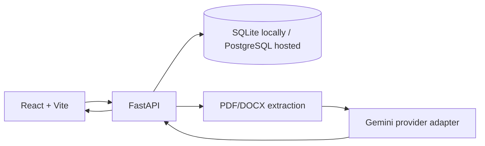

# BidWise AI RFP Writer

A runnable starter for an AI-assisted RFP analysis and response workflow. Built for Windows + VS Code.

## What's included
- React + TypeScript + Vite frontend with responsive enterprise layout.
- FastAPI backend with SQLite persistence, health checks, RFP CRUD, document upload, analysis records, and qualification scoring.
- PDF/DOCX text extraction with page/paragraph metadata where available.
- Server-side Gemini provider adapter (optional). If no API key is configured, analysis reports that AI is unavailable; it does not fabricate an AI response.
- Explicitly labeled demo records.
- Basic backend tests and environment examples.

## Current scope
This ZIP is a runnable foundation, not a claim that every enterprise feature in the master specification is already production-complete. Discovery crawling, production-grade authentication/RBAC, robust OCR, vector RAG, XLSX/PDF export, and full review/version workflows are follow-on implementation stages. The starter is designed so these can be added without replacing the foundation.

## Prerequisites
- Python 3.11 or 3.12 recommended.
- Node.js 20 LTS or newer.
- VS Code.

## Run on Windows
Open this folder in VS Code. Open two terminals.

### Terminal 1 — backend
```powershell
cd backend
py -3.12 -m venv .venv
.\.venv\Scripts\Activate.ps1
python -m pip install --upgrade pip
pip install -r requirements.txt
Copy-Item .env.example .env
uvicorn app.main:app --reload
```
If `py -3.12` is unavailable, use `python -m venv .venv` with a supported Python version.

Backend health: http://127.0.0.1:8000/health  
API docs: http://127.0.0.1:8000/docs

### Terminal 2 — frontend
```powershell
cd frontend
npm install
Copy-Item .env.example .env
npm run dev
```
Open the URL Vite prints, usually http://localhost:5173.

## Optional Gemini configuration
Add `GEMINI_API_KEY` to `backend/.env`. The key stays on the server and must never be put in a `VITE_` variable. The provider/model can change over time; check Google's current Gemini API model availability and free-tier quota before use. Missing key or quota errors are surfaced as errors, not replaced with fake answers.

## Demo data
The API seeds clearly labeled synthetic demo records on first startup. These are not live discoveries or real business opportunities. Delete them through the API or local database if you prefer an empty workspace.

## Tests
From `backend/` with the virtual environment activated:
```powershell
pytest
```

## Deployment notes
- Frontend: Netlify build command `npm run build`, publish directory `dist`.
- Backend: deploy the `backend` directory to a Python host with `uvicorn app.main:app --host 0.0.0.0 --port $PORT`.
- Set `DATABASE_URL` to a persistent database URL for hosted use. SQLite on an ephemeral host is not durable.
- Set `CORS_ORIGINS` to the exact deployed frontend origin.
- Configure an admin secret before exposing destructive administrative operations; this starter keeps destructive endpoints out of the public UI, but a full production deployment still needs server-side authorization hardening.
- Free tiers may sleep, impose quotas, or change. No unlimited/free/permanent AI availability is promised.

## Architecture


## Troubleshooting
- `py` not found: install Python and enable the Python launcher, or use `python`.
- PowerShell blocks activation: run `Set-ExecutionPolicy -Scope Process -ExecutionPolicy Bypass` in that terminal, then activate again.
- Port 8000 busy: `uvicorn app.main:app --reload --port 8001`.
- Port 5173 busy: Vite automatically offers another port.
- Gemini 429/quota: wait or review provider quota; no fake fallback is generated.
