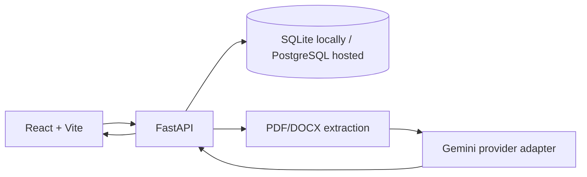

<div align="center">

# 🚀 BidWise AI

### AI-Powered RFP Analysis & Response Workspace

**Turn complex RFP documents into structured requirements, risk insights, and review-ready findings.**

<p>
  
  
  
  
  
</p>
<p>
  
  
  
  
  
</p>

</div>

---

## ✨ Overview

**BidWise AI** is a web application starter for AI-assisted Request for Proposal (RFP) analysis. Upload a PDF or DOCX document to extract its text, request a structured AI analysis, and review requirements and findings in a dashboard-oriented workspace.

The application combines a React + TypeScript frontend with a FastAPI backend. Gemini integration is performed server-side, keeping the provider key out of the browser.

> **Project status:** This repository is a runnable starter with core API endpoints and document-analysis integration. It is not yet a complete enterprise procurement automation platform. AI availability depends on provider access, model availability, quotas, and service status.

## 🎯 Core Features

| Feature | Description |
| --- | --- |
| 📊 Dashboard | View RFP workspace summaries and activity metrics. |
| 📄 PDF/DOCX extraction | Extract text from supported PDF and Word documents. Scanned PDFs require OCR, which is not included. |
| 🤖 Gemini analysis | Request a document summary, RFP classification, requirements, priorities, risks, and warnings. |
| 🧾 RFP records | Create, list, search, and delete supported RFP records through the API, with demo records clearly labeled. |
| 🔎 Findings & review | Store analysis results and update requirement review statuses. Human verification remains necessary. |
| 📈 Analytics | Calculate metrics from saved RFP and analysis records. |
| ✍️ Response drafting | Generate a draft from a requirement and supplied evidence when Gemini is available. |
| 🛡️ Server-side API key | Keep the Gemini key in backend environment configuration rather than frontend code. |

## 🖥️ Project Structure

```text
BidWise-AI/
├── backend/
│   ├── app/
│   │   ├── main.py           # FastAPI routes and API endpoints
│   │   ├── services.py       # Document extraction and Gemini calls
│   │   ├── config.py         # Environment-based settings
│   │   ├── database.py       # Database connection and sessions
│   │   ├── models.py         # SQLAlchemy models
│   │   └── schemas.py        # Request/response schemas
│   ├── .env.example
│   └── requirements.txt
├── frontend/
│   ├── src/
│   ├── .env.example
│   ├── package.json
│   └── vite.config.ts
└── README.md
```

## 🚀 Run Locally on Windows

Open the project folder in VS Code and use **two terminals**.

### 1. Start the backend

Start FastAPI:

```powershell
uvicorn app.main:app --reload
```

- API health: [http://127.0.0.1:8000/health](http://127.0.0.1:8000/health)
- Interactive API docs: [http://127.0.0.1:8000/docs](http://127.0.0.1:8000/docs)

### 2. Start the frontend

Open a second terminal:

```powershell
cd frontend
npm install
Copy-Item .env.example .env
npm run dev
```

Open the local URL printed by Vite, usually [http://localhost:5173](http://localhost:5173).

Set the frontend API base URL using the variable expected by the frontend (for example, `VITE_API_URL=http://127.0.0.1:8000`), if required by your `.env.example`.

## 🔐 Environment Variables

### Backend

| Variable | Purpose |
| --- | --- |
| `GEMINI_API_KEY` | Secret key used by the backend to call Gemini. |
| `GEMINI_MODEL` | Optional model override if supported by the configuration; use a model available to your API project. |
| `CORS_ORIGINS` | Comma-separated frontend origins allowed to call the API. |
| `DATABASE_URL` | Optional database connection URL. SQLite is the starter default. |

Check `backend/app/config.py` and `backend/.env.example` for exact variable names and defaults.

### Frontend

| Variable | Purpose |
| --- | --- |
| `VITE_API_URL` | Backend API base URL embedded at frontend build time. |

**Never place `GEMINI_API_KEY` in a `VITE_` variable.** Frontend variables are visible to browser users.

## ☁️ Deployment

### Frontend — Netlify

- Connect the GitHub repository.
- Set the base directory to `frontend` (or use the equivalent root-level build configuration).
- Build command: `npm run build`
- Publish directory: `dist`
- Set `VITE_API_URL` to the deployed backend URL.
- Redeploy after changing build environment variables.

### Backend — Render

- Deploy the `backend` directory as a Python web service.
- Start command:

```bash
uvicorn app.main:app --host 0.0.0.0 --port $PORT
```

- Configure `GEMINI_API_KEY`, the supported model setting, and `CORS_ORIGINS` in Render's environment settings.
- Set `CORS_ORIGINS` to the exact deployed frontend origin.
- For durable production data, configure a persistent database. Ephemeral local SQLite storage may not survive service restarts or redeploys.

## 🧪 Verification

1. Open `/health` on the backend and confirm the service responds.
2. Open `/docs` and inspect the available API endpoints.
3. Upload a text-based PDF or DOCX using the analysis endpoint.
4. Confirm the response includes a summary and structured findings.
5. Verify saved records and analytics using the API and frontend.

If AI analysis fails, inspect backend logs and provider error details. Model availability, API access, quotas, and temporary provider outages can affect results.

## 📄 License

This project is licensed under the MIT License. See [`LICENSE`](LICENSE) if included in the repository.

---

<div align="center">

**Built with React, FastAPI, and Gemini API** 💙

*Analyze documents. Organize requirements. Review with evidence.*

</div>


## Architecture


## Troubleshooting
- `py` not found: install Python and enable the Python launcher, or use `python`.
- PowerShell blocks activation: run `Set-ExecutionPolicy -Scope Process -ExecutionPolicy Bypass` in that terminal, then activate again.
- Port 8000 busy: `uvicorn app.main:app --reload --port 8001`.
- Port 5173 busy: Vite automatically offers another port.
- Gemini 429/quota: wait or review provider quota; no fake fallback is generated.
